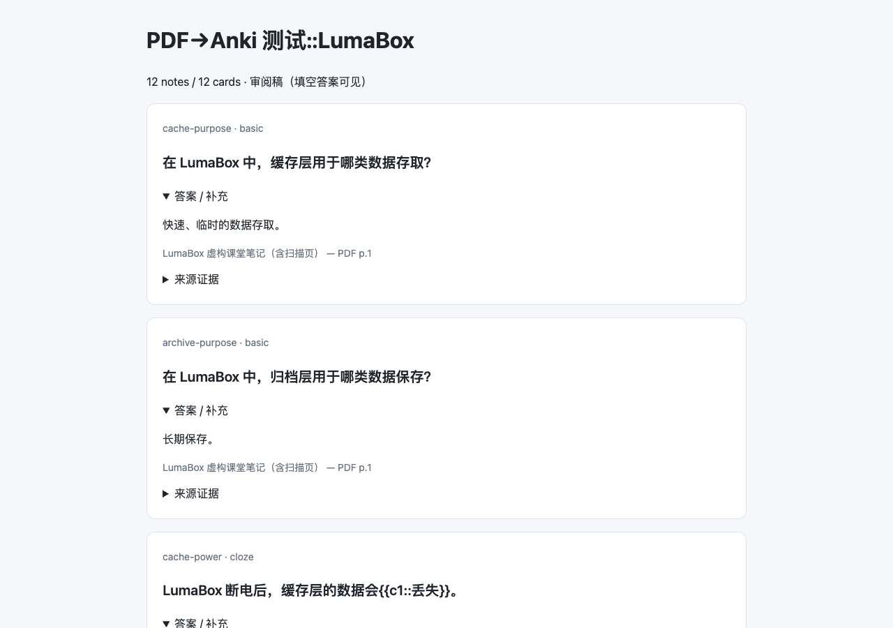
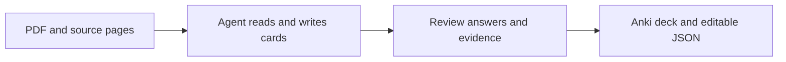

# Anki Card Skills

**English** · [简体中文](README.zh-CN.md)

Reading something once feels good. Remembering it next month feels better.

**[Browse the sample cards](examples/lumabox/output/review.md)** · **[Download the Anki deck](https://github.com/Bill306/anki-card-skills/raw/refs/heads/main/examples/lumabox/output/deck.apkg)** · **[Product decisions and walkthrough](https://github.com/Bill306/Bill306/blob/main/projects/anki/README.md)**

## Explore in a minute

Open the [four-page source PDF](examples/lumabox/lumabox-test.pdf), then inspect the [cards, answers, and page references](examples/lumabox/output/review.md). The included LumaBox teaching example is fictional and labeled in the source. Its [coverage audit](examples/lumabox/output/audit.json) also shows a source question that remains unanswered. Downloading the `.apkg` lets you import the 12-card sample into Anki through File → Import.

The [product case](https://github.com/Bill306/Bill306/blob/main/projects/anki/README.md) explains three choices: answers with evidence, visible source gaps, and stable identity when revising cards. You can browse the source and review on GitHub; importing requires Anki, and generating your own cards requires the installed Skill and an Agent.





An Agent Skill for turning PDFs into reviewable Anki cards with source pages. The agent reads text, charts, and scanned pages, chooses knowledge worth remembering, reviews each card, and exports an `.apkg` alongside editable material.

[Card-writing rules](skills/pdf-to-anki/references/card-rules.md) · [Skill](skills/pdf-to-anki/SKILL.md) · [Example deck](examples/lumabox/output/deck.apkg) · [Verification](docs/verification.md)

## What makes a useful card?

- One independent recall target per card, with enough context to understand it.
- Clear questions, short answers, and separate explanations.
- Conditions, units, exceptions, and negation preserved.
- Evidence and physical PDF page numbers for every answer.
- A coverage review that records duplicates and unresolved source gaps.

The agent writes and reviews the content. Python helpers preprocess PDFs, check structure, and package cards. No Memo account or dedicated model API is required.

## Install and use

Place [skills/pdf-to-anki](skills/pdf-to-anki) in your agent's skills directory, such as `~/.codex/skills/pdf-to-anki/`. Compare an existing installation before replacing files.

```text
Use $pdf-to-anki to make Anki cards from this PDF. Prefer question-and-answer
cards, use cloze where helpful, preserve source pages, and review the cards.
Return the .apkg, review document, and cards.json.
```

Executable preprocessing accepts PDFs. Export slides to PDF first; speaker notes require separate source handling.

## Local helpers

Requires Python 3.10+. From the repository root:

```bash
python3 -m venv .venv
.venv/bin/python -m pip install -r skills/pdf-to-anki/requirements.txt
.venv/bin/python skills/pdf-to-anki/scripts/prepare_pdf.py input.pdf --out work/source-a
```

The agent reads `source.md` and rendered pages in `work/source-a/pages/`, then creates `cards.json` using the [schema](skills/pdf-to-anki/references/schema.md). After review:

```bash
.venv/bin/python skills/pdf-to-anki/scripts/export_anki.py cards.json --out output
```

The output directory must not already exist.

| Output | Purpose |
| --- | --- |
| `deck.apkg` | Import into Anki; Basic and single-cloze cards |
| `cards.json` | Editable card content, IDs, and sources |
| `review.md`, `review.html` | Human review; HTML embeds local evidence images |
| `audit.json` | Structural checks, source coverage, and package checks |
| `cards.tsv` | Optional manual import with appropriate field mapping |

Stable deck/card IDs preserve note GUIDs across exports. Actual updates also depend on Anki import settings and local edits; see [verification](docs/verification.md).

## Example and limits

The authored classroom example in [examples/lumabox](examples/lumabox) contains a four-page PDF and 12 cards: 10 Basic, 2 Cloze, and one media image. The verification document records official Anki backend import, repeated-import, and answer-update checks. This example includes an unanswered source value, so its coverage is labeled `PARTIAL_SOURCE_COVERAGE`.

Basic, single-cloze, and image-assisted cards are supported. Native Image Occlusion is not implemented. Scanned pages depend on the executing agent's OCR or image-reading capability. Structural checks do not establish educational or semantic quality. The helpers do not import into or modify your personal Anki collection.

To run the existing verification suite:

```bash
.venv/bin/python -m pip install -r requirements-test.txt
.venv/bin/python tests/checks.py
```

It creates an isolated example collection in a system temporary directory. See [verification](docs/verification.md) for the recorded results and boundaries.

## Sources and license

[Design basis](skills/pdf-to-anki/references/design-basis.md) documents the public learning practices behind the rules. Packaging uses genanki and PDF processing uses PyMuPDF, each under its own license. Version: [VERSION](VERSION). Repository: [MIT](LICENSE).
