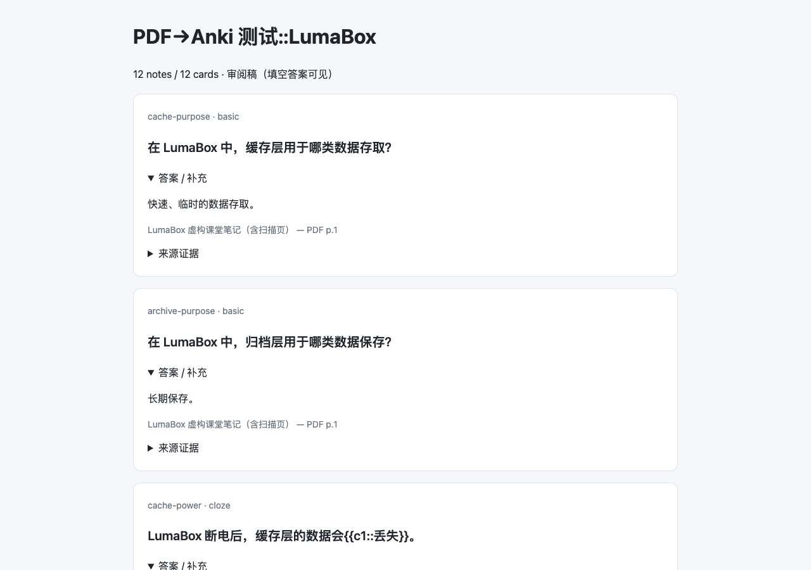

# Anki Card Skills

[English](README.md) · **简体中文**

把读过的材料，变成真正能拿来复习的 Anki 卡片。



这是一套给 AI Agent 使用的中文 Skill：先理解 PDF 的正文、图表和扫描页，提炼知识点，再生成带页码来源的问答卡或填空卡，复核后导出 `.apkg`。

**[阅读完整制卡规则](skills/pdf-to-anki/references/card-rules.md)** · **[查看 Skill](skills/pdf-to-anki/SKILL.md)** · **[下载示例牌组](examples/lumabox/output/deck.apkg)** · **[验证说明](docs/verification.md)**

## 它解决什么问题

直接要求 AI “把这份 PDF 变成卡片”，容易得到过长答案、重复考点、一张卡问几个问题，或没有来源的结论。本 Skill 把阅读、知识点筛选、拆卡、核对和导出分开，让生成结果可以检查、修改和重新打包。

它需要由当前 Agent 阅读并制卡。随附 Python 脚本负责 PDF 预处理、数据校验和 Anki 打包；它不是一个脱离 Agent 后会自动生成内容的独立 App，也不需要 Memo 账号或专用模型 API。

## 核心规则

- 一个独立的回忆目标一张卡，保留理解它所需的上下文。
- 先列知识点，再决定卡片数量，合并重复并记录未覆盖项。
- 问题明确，答案简短，解释单列；保留条件、单位、否定和例外。
- 每个答案有资料证据和 PDF 物理页码，不用常识填补未提供的事实。
- 检查图表和扫描页；认不清的内容保留为待核对项。
- 导出真实 `.apkg`，同时保留可编辑 JSON 和审阅稿。

完整规则另含题干、答案、问答、填空、选择题、图片、数字、公式、流程、分类、图表、事实约束、覆盖和最终审查。

## 安装与调用

Skill 位于 `skills/pdf-to-anki/`。将这个目录放入你的 Agent 支持的 skills 目录中；确保目标同名目录不存在，已有版本先比较后再更新。

例如 Codex 使用 `~/.codex/skills/pdf-to-anki/`。如果环境使用共享 skills 根目录，则安装到该共享根目录即可。让 Agent 加载其中的 `SKILL.md`，或在新会话中调用：

> 用 $pdf-to-anki 把这份 PDF 做成中文 Anki 卡片。问答为主，必要时填空；保留来源页码，复核后交付 .apkg、审阅稿和 cards.json。

规则可用于 PPT 和课堂笔记的制卡设计；本仓库的可执行预处理以 **PDF** 为输入。PPT 先转为 PDF；不能据此声称已读取备注页。其他笔记如需使用随附 PDF 页码协议，先整理成 PDF，或自行适配来源格式。

## 本地脚本

需要 Python 3.10+。在本仓库根目录执行：

```bash
python3 -m venv .venv
.venv/bin/python -m pip install -r skills/pdf-to-anki/requirements.txt
.venv/bin/python skills/pdf-to-anki/scripts/prepare_pdf.py input.pdf --out work/source-a
```

Agent 阅读 `work/source-a/source.md` 和 `pages/` 中的渲染图，按 [schema](skills/pdf-to-anki/references/schema.md) 生成 `cards.json`，逐卡复核后导出：

```bash
.venv/bin/python skills/pdf-to-anki/scripts/export_anki.py cards.json --out output
```

输出目录必须尚不存在，避免覆盖已有结果。交付包括：

| 文件 | 用途 |
|---|---|
| `deck.apkg` | Anki → 文件 → 导入；支持问答和单空填空 |
| 原始 `cards.json` | 修改答案、来源或知识点后重新导出 |
| `review.md` / `review.html` | 阅读和审查卡片；HTML 内嵌本地证据图片 |
| `audit.json` | 结构、来源范围、缺口及包完整性检查 |
| `cards.tsv` | 检查或手动字段映射后的备用导入，不是混合卡型的一键替代品 |

保持 deck.id 与 card.id 可以让重新导出的 note 保持 GUID。实际更新受 Anki 导入选项和本地修改影响，参见 [Anki 官方说明](https://docs.ankiweb.net/manual/importing/packaged-decks)。

## 示例与验证

`examples/lumabox/` 是自编的虚构课堂资料，不对应真实产品。四页 PDF 含中文、表格、流程说明及一页纯图片扫描页；样例产出 **12 notes / 12 cards、10 张问答、2 张填空及 1 个媒体图片**。

已使用 Anki 官方 Python 后端 **26.9.3** 在隔离 collection 实际验证导入、图片、重复导入和答案更新；同时检查了来源、覆盖、数学字符、文件保留及 ZIP/SQLite 完整性。详见 [验证边界与结果](docs/verification.md)。

复跑测试：

```bash
.venv/bin/python -m pip install -r requirements-test.txt
.venv/bin/python tests/checks.py
```

测试会把虚构示例复制到新的系统临时目录并在那里创建隔离的 Anki collection；不会访问真实用户牌组。临时结果保留以便检查。无须为了使用 Skill 安装 Anki 测试后端。

## 当前边界

- 支持 Basic、单空 Cloze 和图片辅助，尚不实现原生 Image Occlusion。
- 扫描页依赖执行 Agent 的视觉/OCR能力；预处理脚本自身不做 OCR。
- 自动校验能验证结构，不能证明语义和教育效果；Agent 仍需阅读与审卡。
- 示例特意包含一个资料未提供的数值，因此 audit 标为 `PARTIAL_SOURCE_COVERAGE`；包本身可以正常导入。
- 不自动导入、同步或修改用户真实 Anki。

## 来源与依赖

方法参考公开制卡实践和 Memo 的可见产品行为，采用独立实现；没有复制 Memo 应用代码或取得其隐藏系统提示词。见 [设计依据](skills/pdf-to-anki/references/design-basis.md)。导出使用 [genanki](https://github.com/kerrickstaley/genanki)，PDF 处理使用 [PyMuPDF](https://pymupdf.readthedocs.io/)。这些依赖分别适用各自许可证。

当前版本：`0.1.0`，见 [VERSION](VERSION)。本仓库采用 [MIT License](LICENSE)，允许使用、修改和再分发；第三方依赖适用各自许可证。
